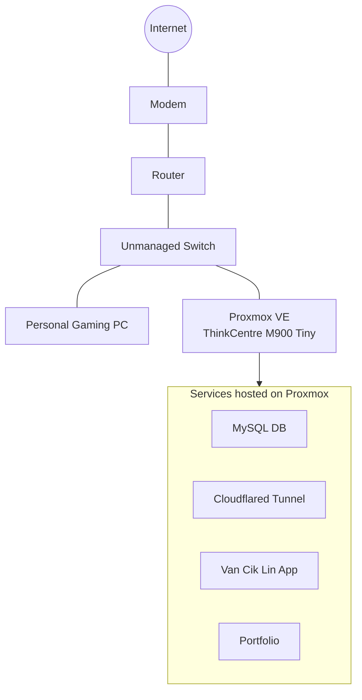

# homelab network architecture

## overview
the homelab uses a combination of local structure, DNS management, and cloudflare tunnel connectivity to make selected services accessible without relying exclusively on direct inbound port forwarding.

the designed evolved from virtualization environment into a dedicated proxmox host with multiple LXC

## core components
| component | responsibility |
|-----------|----------------|
|proxmox ve|host and manages virtualized workloads|
|linux containers|isolate individual services|
|hostinger|domain registration or domain-management provider, as applicable|
|cloudflare dns| dns management for configured domain|
|cloudflare tunnel|provides outbound tunnel connectivity for configured services|
|nginx|serves portfolio website and may act as a reverse proxy|
|mysql|store application database|

## current network architechture

the homelab uses a simple home network topology.

- **modem** - provides connection to the internet.
- **router** - connects the home network to the the internet.
- **unmanaged switch** - provides ethernet connectivity to the personal pc and proxmox host
- **personal pc** - personal pc connected to the home network
- **proxmox host** - Lenovo ThinkCentre M900 Tiny running virtualized and containerized servuces.

the proxmox host several LXC containers and application hosting, database service, network tunneling and homelab management.
