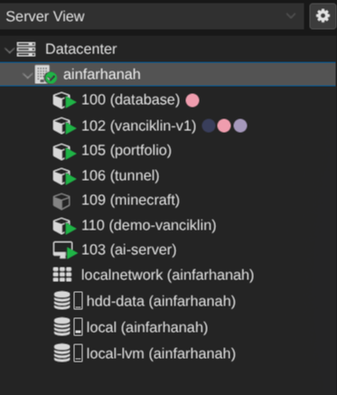

# hosted services and experiments

overview of virtual machines (VMs) and Linux containers (LXCs) running on my Proxmox VE host.

## production services
core infrastructure and live applications running 24/7.

|LXC ID|Service|Purpose|
|------|-------|-------|
|100| MySQL DB| provides database storage for van cik lin app|
|102| Van Cik Lin App | hosts an invoicing system and payment-tracking app for my mother's school transport business|
|105| portfolio|hosts my portfolio using nginx|
|106| cloudflare tunnel| cloudflare tunnel connectivity|

## experimental services
|service|purpose|
|-------|-------|
|vanciklin demo| staging and in-development instance of the Van Cik Lin app|
|minecraft| better minecraft 5 server experiment|
|ai-server| local LLM inference experiment running Ollama|

## services overview
